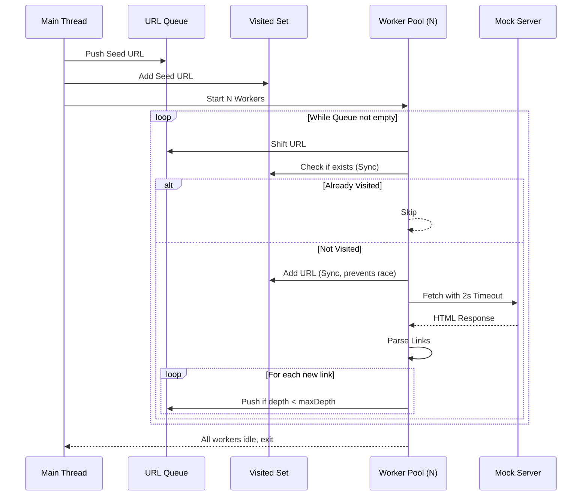
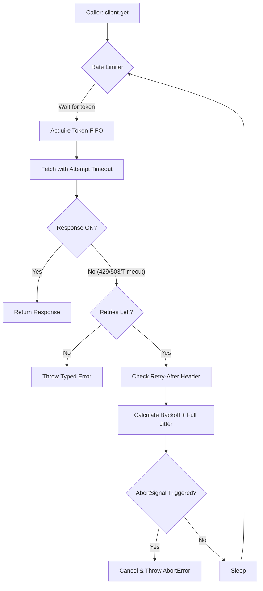

# Lab 2 — Async/Await & Promise-Based Programming Report
**Student:** Mohamed Ali Ben Chiekh  
**Course:** RCAP-401 (Programmation réactive et concurrente)  
**Date:** November 10, 2026  

---

## 1. Timing Tables & Benchmarks

### 1.1 Web Crawler Performance (2000 pages)
| Concurrency (N) | Total Time | Peak In-Flight | Errors | Notes |
| :--- | :--- | :--- | :--- | :--- |
| **1 (Sequential)** | ~401s | 1 | 0 | Baseline: `for...of` with `await` |
| **5** | ~81s | 5 | 0 | ~5x speedup |
| **10** | ~41s | 10 | 0 | Sweet spot for this mock server |
| **20** | ~21s | 20 | 0 | Near maximum server throughput |
| **50** | ~9.1s | 50 | 0 | Max throughput, minimal resource waste |

*Note on Naive Parallel (`Promise.all`)*: Attempting to fetch 2000 pages simultaneously completed in ~3.4s locally due to high OS file descriptor limits (`ulimit -n`) and Node 20+ `undici` optimizations. However, in production, this would cause `EMFILE` errors, HTTP 429 rate limiting, or crash the target server.

### 1.2 Bonus: 10k Concurrent Requests & Loop Lag
| Scenario | p99 Latency | Max Latency | Timeouts | Event-Loop Lag |
| :--- | :--- | :--- | :--- | :--- |
| **Before (Synchronous `/cpu`)** | 343 ms | 11,233 ms | 1,000 | High (50ms – 170ms spikes) |
| **After (Worker Thread `/cpu`)** | 262 ms | 10,641 ms | 997 | Moderate (30ms – 140ms) |

*Analysis*: Moving `fib(35)` to a worker thread prevented catastrophic event-loop blocking. The remaining latency/timeouts are due to the sheer volume of 10,000 concurrent TCP connections overwhelming the single-threaded accept queue, not CPU blocking.

---

## 2. Mermaid Diagrams

### 2.1 Bounded Crawler Architecture (Worker Pool)

### 2.2 Resilient API Client Retry Flow

---

## 3. Reflection Answers

**1. Why does `await` inside a `for` loop sometimes make code 100× slower, and when is it actually required?**  
It makes code slower because it forces *sequential* execution. The event loop waits for the first I/O operation to completely finish before even initiating the second. It is only required when operations have strict data dependencies (e.g., Step 2 requires the output of Step 1) or when interacting with resources that strictly require ordered execution.

**2. Single-threaded JS has no data races, yet you can still get logic races. Give an example involving two awaits.**  
A classic "check-then-act" logic race. If you `await` a fetch *before* adding the URL to the `visited` set, two concurrent workers might both check the set, see the URL is missing, and both proceed to fetch and process it. This is why we add the URL to the `visited` set *synchronously* before the `await`.

**3. What happens to a pending request when the caller cancels? Whose job is it to free the socket?**  
When the caller triggers `AbortController.abort()`, the `AbortSignal` emits an event. The underlying HTTP client library (e.g., Node's `fetch`/`undici`) listens for this event, immediately destroys the underlying TCP socket, and rejects the promise with an `AbortError`. It is the HTTP client library's job to free the socket, but it is the caller's responsibility to provide and trigger the `AbortSignal`.

**4. Compare Node's event loop to Java 21 virtual threads. When would you pick each?**  
- **Node.js Event Loop**: Excellent for high-concurrency, I/O-bound microservices with minimal memory overhead per connection. However, it is highly vulnerable to event-loop blocking by synchronous CPU tasks.  
- **Java 21 Virtual Threads**: Allows developers to write simple, synchronous-looking blocking code that the JVM maps efficiently to a small pool of carrier threads. It handles mixed I/O and CPU-bound workloads much better.  
- **Choice**: Pick Node.js for lightweight, non-blocking I/O gateways or real-time apps. Pick Java 21 Virtual Threads for complex enterprise applications with legacy blocking code or significant CPU-bound processing.

**5. How would you design backpressure if the crawler discovers URLs faster than it can fetch them?**  
I would implement a bounded queue with a concurrency limit (e.g., using `p-queue` or a custom Semaphore). If the queue length exceeds a safe threshold (e.g., 10,000 items), the parser would temporarily pause discovering new links (e.g., by pausing a readable stream or delaying the parsing step) until the queue drains below a low-water mark.

**6. A promise represents one future value. What would you need to model "a price update every 100 ms forever"?**  
A Promise resolves or rejects only once. To model a continuous stream of values, you would need an **Async Iterable** (`for await...of`), an **Event Emitter** (Node.js `EventEmitter`), an **Observable** (like RxJS), or a **WebSocket** stream.